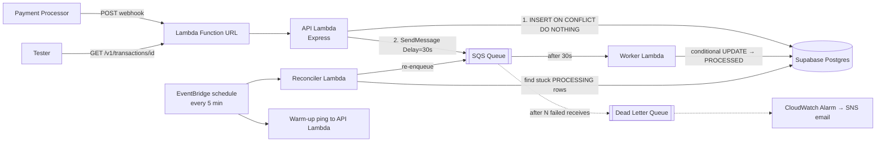

# Transaction Webhook Service — Implementation Plan

> Status: **PLAN ONLY — no code written yet.** Review, then approve to start implementation.

---

## 1. Goal

A service that receives payment-processor transaction webhooks (RazorPay-style), **acknowledges within 500 ms with `202`**, and **reliably processes each transaction exactly once** in the background after a **30-second delay**, persisting the result.

### Requirement → design traceability

| # | Requirement | How the design satisfies it |
|---|---|---|
| 1 | `POST /v1/webhooks/transactions`, `GET /`, `GET /v1/transactions/{id}` | Express routes on a Lambda behind a public Function URL |
| 2 | 202 within 500 ms regardless of load | Request path does only: validate → 1 DB insert → 1 SQS send. No processing inline |
| 3 | 30 s background processing, persisted result | SQS `DelaySeconds=30` → worker Lambda → UPDATE row in Supabase Postgres |
| 4 | Idempotency on `transaction_id` | `PRIMARY KEY` on `transaction_id` + `INSERT … ON CONFLICT DO NOTHING`; worker uses atomic conditional UPDATE |
| 5 | Persistent storage with status + timings | `transactions` table (`status`, `created_at`, `processed_at`) |
| 6 | Reliability, no lost transactions | Durable-before-ack write, SQS retries + DLQ, re-enqueue on failure, scheduled reconciler |
| 7 | Scalable, modern architecture | Serverless, event-driven, stateless compute, queue-based load levelling, IaC, CI/CD |
| 8 | Public cloud URL + GitHub repo + README | AWS Lambda Function URL, public repo, README with run/test/choices |

---

## 2. Decisions (confirmed with you)

| Area | Decision | Reason |
|---|---|---|
| Language / framework | **Node.js (plain JavaScript, ESM) + Express 5** | Most familiar framework, easy to explain, no build step. *(Changed from TypeScript → JavaScript, and from Fastify → Express, at your request.)* Framework cost is ~1 ms of the 500 ms budget; the budget is dominated by DB/SQS/cold start, which are framework-independent. Safety comes from runtime validation (Ajv JSON schemas on the request, zod on config), DB constraints, JSDoc types and tests. Lambda adapter: `@codegenie/serverless-express` |
| Compute | **AWS Lambda** (arm64, Node 22 LTS) | Always-free tier, auto-scales to zero/up |
| Public entry | **Lambda Function URL** (HTTPS) | Free; API Gateway is not free for new AWS accounts |
| Queue / delay | **Amazon SQS** with `DelaySeconds=30` + **DLQ** | Native delay, durable, retries, free tier |
| Database | **Supabase Postgres** (via Supavisor pooler) | Your choice; strong constraints = bulletproof idempotency, `NUMERIC` for money |
| IaC / deploy | **AWS SAM** | Simplest for Lambda + SQS + EventBridge |
| Signature check | **Optional HMAC-SHA256**, enforced only when `WEBHOOK_SECRET` is set | Realistic for payment webhooks; does not break evaluator's plain POSTs |
| Extras | **GitHub Actions CI/CD, unit + integration tests, observability** | Per your selection |
| Region | **ap-southeast-2 (Sydney)** for AWS **and** Supabase | *Originally ap-south-1 (Mumbai) for the INR use case. Changed after a multi-region probe (`scripts/diagnose-aws-access.sh`) showed the account's AWS Organization blocks regional services in Mumbai, Singapore, Seoul, Ireland and Oregon. Sydney is the closest allowed region to India.* The database must stay in the same region as the Lambdas (critical for the 500 ms budget) |

### Alternatives considered (and why not)
- **BullMQ + Redis**: needs an always-on worker; doesn't fit Lambda and Redis is not free on AWS.
- **setTimeout in-process**: loses jobs on restart/deploy — fails the reliability criterion.
- **API Gateway HTTP API**: adds cost for new accounts with no benefit here.
- **FIFO SQS**: extra constraints (per-queue delay only, lower throughput); DB constraint already gives dedup.
- **ORM (Prisma/Drizzle)**: unnecessary weight on cold starts for 1 table; plain `pg` + SQL is enough.

---

## 3. Architecture



### Lambdas (3 functions, 1 shared codebase)
1. **api** — Express app: health, webhook, query. Latency-critical path.
2. **worker** — SQS-triggered; performs the (simulated) external call and finalises the transaction.
3. **reconciler** — scheduled; self-heals transactions whose message was never enqueued or got lost; also keeps Supabase free project from pausing.

---

## 4. API contract

### `POST /v1/webhooks/transactions`
- Body: `transaction_id` (string, required, non-empty, max ~64), `source_account`, `destination_account` (strings, required), `amount` (number > 0, finite, ≤ 2 decimals unless currency needs more), `currency` (ISO-4217, 3 uppercase letters).
- **202 Accepted** `{ "status": "ACCEPTED" }` for new transactions.
- **202 Accepted** `{ "status": "ACCEPTED", "duplicate": true }` for repeated `transaction_id` — never an error.
- **400** for invalid payload (clear message). **401** only if `WEBHOOK_SECRET` is set and the `X-Webhook-Signature` header is missing/invalid.
- **500** only if the transaction could not be durably stored/enqueued (so the processor retries — safe because of idempotency).

### `GET /` — health
`200 { "status": "HEALTHY", "current_time": "<ISO-8601 UTC>" }`. No DB call (must stay instant).

### `GET /v1/transactions/{transaction_id}`
- `200` → **array** with one object (as per your spec): `transaction_id, source_account, destination_account, amount, currency, status (PROCESSING | PROCESSED | FAILED), created_at, processed_at (null while processing)`.
- `404` with empty array/`{error}` when unknown (assumption — see §14).

---

## 5. Data model — table `transactions`

| Column | Type | Notes |
|---|---|---|
| `transaction_id` | text, **PRIMARY KEY** | Idempotency key |
| `source_account` | text, not null | |
| `destination_account` | text, not null | |
| `amount` | numeric(20,4), not null | Never float; converted to JS number only at the API edge |
| `currency` | char(3), not null | |
| `status` | text, not null, check in (PROCESSING, PROCESSED, FAILED) | default PROCESSING |
| `created_at` | timestamptz, not null | default now() |
| `enqueued_at` | timestamptz, null | Set after SQS send succeeds; used for recovery |
| `processed_at` | timestamptz, null | Set by worker |
| `attempts` | int, default 0 | Diagnostics |
| `last_error` | text, null | Diagnostics |

Index: partial index on `(created_at)` where `status = 'PROCESSING'` for the reconciler.
Migrations: versioned SQL files in `/migrations`, applied by a migrate script using the **direct** (non-pooled) Supabase connection.

---

## 6. Core flows

### 6.1 Webhook (hot path — target p95 < 150 ms warm)
1. (Optional) Verify HMAC over the **raw body**; constant-time compare.
2. Validate body against JSON schema → 400 on failure.
3. `INSERT … ON CONFLICT (transaction_id) DO NOTHING RETURNING` → durable **before** we ack.
4. **Inserted** → send SQS message `{transaction_id}` with `DelaySeconds=30` → mark `enqueued_at`.
5. **Conflict** → read existing row: if still `PROCESSING` and `enqueued_at IS NULL` → re-enqueue (heals earlier SQS failure); otherwise do nothing.
6. Return `202`.
- If step 4 SQS send fails → return `500`; processor retries; step 5 repairs. The reconciler is the safety net if the processor never retries.

### 6.2 Worker
1. Receive message (batch size 1–10, partial batch failure reporting enabled).
2. Atomic claim: conditional `UPDATE … WHERE transaction_id = ? AND status = 'PROCESSING'`.
3. Run `processTransaction()` — isolated function simulating the external API call (swappable for a real integration). The 30 s wait is provided by the queue delay, so Lambda is **not billed for idle waiting**.
4. Set `status = PROCESSED`, `processed_at = now()`.
5. Already `PROCESSED`/missing → ack silently (duplicate delivery is harmless; SQS is at-least-once).
6. On error → throw for that record → SQS retries (visibility timeout backoff) → after `maxReceiveCount` (5) → DLQ; on final attempt set `FAILED` + `last_error`.

### 6.3 Reconciler (every 5 min)
- Select `PROCESSING` rows older than ~2 min (bounded `LIMIT`, `FOR UPDATE SKIP LOCKED`) → re-enqueue with delay 0. Worker idempotency makes this always safe.
- Runs `SELECT 1`-class activity → prevents Supabase free-tier auto-pause after 7 idle days.

---

## 7. Idempotency & reliability matrix

| Failure | Outcome |
|---|---|
| Same webhook sent N times (even concurrently) | PK conflict → one row, one effective processing |
| API crashes after DB insert, before SQS send | Processor retry (conflict → re-enqueue) **or** reconciler re-enqueues |
| SQS message delivered twice | Atomic conditional UPDATE → processed once |
| Worker crashes mid-processing | Message reappears after visibility timeout → retried |
| Poison/failed repeatedly | DLQ + alarm; row marked `FAILED`; redrive after fix |
| Supabase briefly down | Webhook returns 500 (processor retries); worker retries via SQS |
| Same `transaction_id`, different payload | First write wins; log a WARN with both hashes (no overwrite) |

---

## 8. Performance plan (500 ms budget)

- Hot path: 1 SQL round-trip + 1 SQS call; no inline processing.
- **Same region** (Lambda ↔ Supabase ↔ SQS) → low single-digit ms DB latency after connect.
- **Supabase transaction pooler (port 6543)**, pool `max = 1` per Lambda container, connection reused across invocations; prepared statements off (required in transaction mode).
- Single bundled file via esbuild (SAM), arm64, 512 MB memory; SDK v3 SQS client only; lazy-init DB.
- **Cold-start mitigation**: EventBridge warm-up ping every 5 min (free). Provisioned concurrency is not free, so not used.
- **Worker concurrency cap** (SQS `MaximumConcurrency`, ~5) protects Supabase connection limits. Note: new AWS accounts can have a low account-level concurrency limit (~10) — verify in console.
- Validate with a load-test script (autocannon) and record numbers in README.

---

## 9. Security

- Optional HMAC-SHA256 signature verification (`X-Webhook-Signature`, secret from env), raw-body based, timing-safe compare.
- Strict schema validation, body size limit, no secrets in logs.
- `DATABASE_URL` supplied as SAM `NoEcho` parameter from GitHub encrypted secrets → Lambda env (KMS-encrypted at rest). Trade-off vs SSM: avoids an extra network call on the cold path.
- Least-privilege IAM: API → `sqs:SendMessage`; worker → `sqs:Receive/Delete`; reconciler → `sqs:SendMessage`.
- GitHub → AWS deploy via an **OIDC role** (no long-lived keys) where the account allows it. **This project's AWS account does not** (an organization SCP explicitly denies `iam:CreateOpenIDConnectProvider`), so it uses a least-privilege **IAM user whose access key is a GitHub secret** — a long-lived credential, scoped to this stack's resources, to be deleted after the assessment. Both modes live in `infra/github-deploy-access.yaml`.
- Supabase: use a dedicated DB user with minimal rights; SSL required.
- Function URL has no built-in throttling/WAF → set reserved concurrency on the API function as a blast-radius limit (documented).

---

## 10. Observability

- Structured JSON logs (pino) with `request_id`, `transaction_id`, `event`, `duration_ms`.
- CloudWatch alarms → SNS email: **DLQ depth > 0**, worker errors, API 5xx, oldest-message age (queue lag).
- Key log events: `webhook.accepted`, `webhook.duplicate`, `enqueue.failed`, `txn.processed`, `txn.failed`, `reconciler.reenqueued`.
- 14-day log retention (free-tier friendly).

---

## 11. Repository layout and coding conventions (as built)

```
/
├─ template.yaml  samconfig.toml      # AWS SAM infrastructure
├─ docker-compose.yml                 # local Postgres
├─ migrations/                        # versioned .sql files
├─ scripts/                           # command-line tools: migrate.js, dev-server.js
├─ src/
│  ├─ app.js                          # createApp(): builds the Express app, never listens
│  ├─ container.js                    # composition root: the only place adapters are chosen
│  ├─ config/env.js                   # environment schema + getConfig()
│  ├─ constants/                      # http-status, error-codes, log-events (no magic strings)
│  ├─ errors/http-errors.js           # errors the HTTP layer maps to responses
│  ├─ middlewares/                    # *.middleware.js — one concern per file
│  ├─ modules/                        # feature modules (routes → controller → service → repository)
│  │  ├─ health/                      #   health.routes.js, health.controller.js
│  │  └─ transactions/                #   transactions.{routes,controller,service,repository,
│  │                                   #     schema,mapper,processor,constants,errors}.js
│  ├─ infrastructure/                 # adapters to the outside world
│  │  ├─ database/                    #   postgres-pool.js, migrator.js
│  │  ├─ queue/                       #   job-queue.js (port), sqs-job-queue.js, in-memory-job-queue.js, job-message.js
│  │  └─ logging/logger.js
│  ├─ lib/webhook-signature.js        # framework-free helpers
│  └─ handlers/                       # AWS Lambda entry points: api.js, worker.js, reconciler.js
├─ tests/                             # mirrors src/
│  ├─ unit/    integration/    helpers/
└─ .github/workflows/                 # ci.yml (lint/test), deploy.yml (SAM deploy + smoke test)  [Phase 7]
```

**Conventions (enforced by tooling, not just by habit)**

| Rule | Enforced by |
|---|---|
| File names are `kebab-case`; role is a suffix (`.service.js`, `.repository.js`, `.controller.js`, `.routes.js`, `.middleware.js`, `.schema.js`, `.mapper.js`, `.constants.js`, `.errors.js`) | ESLint `unicorn/filename-case` |
| Built-ins imported as `node:fs`, never `fs` | ESLint `unicorn/prefer-node-protocol` |
| Cross-folder imports use subpath imports (`#src/…`, `#tests/…`), not `../../..` chains; same-feature files import each other relatively | `package.json` `"imports"` |
| Functions are `camelCase` verbs; factories are `createX`; classes/errors `PascalCase`; constants `UPPER_SNAKE` and `Object.freeze`d | review + ESLint basics |
| Layers only depend downward: routes → controller → service → repository; HTTP knows nothing about SQS/Postgres | structure + tests |
| No magic numbers/strings for HTTP status, error codes, log events, statuses | `src/constants/`, `transactions.constants.js` |
| Named exports only; no `var`, no `==`, no `console` in `src/` | ESLint |
| LF line endings, 2-space indent, final newline | `.editorconfig`, `.gitattributes`, Prettier |
| `npm run check` = lint + format check + all tests | `package.json` |

Design principle: **ports & adapters** — business logic depends on the repository and `JobQueue` interfaces; SQS and Postgres are swappable adapters (the in-memory queue enables full local runs without AWS).

---

## 12. Testing strategy

- **Unit (Vitest)**: schema validation, HMAC verify, duplicate/new/repair branches in service, worker idempotency, error → retry mapping.
- **Integration**: supertest against real Postgres (docker-compose locally, service container in CI) with fake queue; concurrent duplicate webhooks (e.g. 50 parallel) → exactly 1 row & 1 enqueue.
- **Post-deploy smoke test (CI)**: POST webhook → expect 202 < 500 ms → POST duplicates → poll GET until `PROCESSED` (~30–40 s) → assert `processed_at - created_at ≈ 30 s` and single record.
- **Load test**: autocannon on webhook endpoint; report p50/p95/p99.

---

## 13. CI/CD (GitHub Actions)

- **ci.yml** (PRs + push): install → lint → unit + integration tests (Postgres service container).
- **deploy.yml** (main): AWS credentials (OIDC role, or IAM-user keys) → run DB migrations → `sam build` → `sam deploy` (params from secrets) → smoke test against output URL.
- Required GitHub secrets: `AWS_ROLE_ARN` **or** `AWS_ACCESS_KEY_ID` + `AWS_SECRET_ACCESS_KEY`; `DATABASE_URL` (transaction pooler), `DATABASE_URL_DIRECT` (session pooler, for migrations), `WEBHOOK_SECRET` (optional), `ALERT_EMAIL`.

---

## 14. Assumptions (flag any you disagree with)

1. **Spec inconsistencies**: amount/currency examples differ (1500 INR vs 150.50 USD) → both valid; stored exactly as received.
2. **Query returns an array** exactly as spec; unknown ID → `404`.
3. **Invalid payload → 400** (spec's 202 applies to valid webhooks).
4. The **30 s delay is implemented via SQS delay** (not a 30 s sleep in code); `processed_at ≈ created_at + 30 s` (± a few seconds SQS jitter).
5. Duplicate webhook returns **202** (not 409) with `duplicate: true`.
6. Same `transaction_id` with a different payload is ignored (first write wins) and logged.
7. No auth on `GET` endpoints (declared test-only in the brief).

## 15. Known risks & mitigations

| Risk | Mitigation |
|---|---|
| Lambda cold start + TLS to Postgres may exceed 500 ms on the very first request | Warm-up ping, small bundle, same region, pooler; measure and report honestly in README |
| Supabase free project pauses after 7 idle days | Reconciler/warm-up touches DB every 5 min |
| AWS free credits/free plan end (6 months for new accounts; Lambda/SQS stay in always-free limits) | Document teardown (`sam delete`); cost expected ≈ $0 at assessment volume |
| New-account Lambda concurrency limit is low | Cap worker concurrency, document |
| Pooler (transaction mode) quirks | Prepared statements disabled; pool size 1; tested in integration suite |

---

## 16. Execution phases (checklist)

- [ ] **Phase 0 – Accounts**: follow [AWS_SETUP.md](AWS_SETUP.md) — AWS account (note creation date), Supabase project in ap-southeast-2, GitHub public repo, AWS OIDC role, alert email.
- [x] **Phase 1 – Foundation**: JS project (ESM), lint/format, config, logger, DB module, migration #1. *(done: lint clean, 8 tests passing; migrations verified on local Postgres; converted from TypeScript to JavaScript)*
- [x] **Phase 2 – Domain**: repository, queue port + adapters, transaction service (idempotency logic). *(done: 47 tests passing; concurrency tests mutation-checked. Added `REPAIR_GRACE_SECONDS` so a duplicate racing the original request does not double-enqueue; processing uses a row lock `SELECT … FOR UPDATE` instead of a bare conditional UPDATE so the external call runs at most once per commit)*
- [x] **Phase 3 – API**: Express app (migrated from Fastify after Phase 5; same behaviour, 138 tests passing), three endpoints, validation, optional HMAC, error handling. *(originally done with 113 tests; verified with curl against a running local server. Added: Lambda handler `src/handlers/api.js` with warm-up ping, local dev server `npm run dev`. Decisions: 202 body is always `{status:"ACCEPTED", duplicate:bool}`; no type coercion; currency normalised to upper case; unknown id → 404 `{error:{code:"TRANSACTION_NOT_FOUND"}}`; non-JSON content type → 415)*
- [x] **Phase 4 – Background**: worker handler, DLQ behaviour, reconciler. *(done: 135 tests passing. Worker reports per-record `batchItemFailures` and processes sequentially; reconciler throws on partial failure so the error alarm fires. Design change: a `FAILED` transaction is retried when a message arrives (DLQ redrive), only `PROCESSED` is skipped. Needs in Phase 5: `ReportBatchItemFailures` on the event source mapping, `MAX_RECEIVE_COUNT` equal to the redrive policy's `maxReceiveCount`, worker Lambda timeout comfortably above batch time)*
- [x] **Phase 5 – Infra**: `template.yaml` (functions, queue, DLQ, alarms, schedules, Function URL, IAM). *(done and validated offline in a Linux container: `cfn-lint` clean, `sam validate --lint` OK, `sam build` OK, and the built bundles pass a runtime smoke test against Postgres. NOT yet deployed — needs the AWS account.)*
  - Choices: worker timeout 20 s ↔ queue visibility timeout 120 s (6×; also the gap between retries); `MaxReceiveCount` is one parameter feeding both the redrive policy and the worker; `ReportBatchItemFailures` on; worker concurrency capped (`WorkerMaxConcurrency`, default 5); API reserved concurrency optional (`ApiReservedConcurrency`, default off because brand-new accounts often can't reserve any); esbuild ESM bundles named `.mjs` with a `require` shim; both Function-URL permissions stated explicitly (Oct 2025 change); log groups with 14-day retention.
  - Alarms (→ SNS email): DLQ not empty, queue backlog > 5 min, transaction marked FAILED, API unhandled error, API throttled, worker errors, reconciler errors.
  - Reconciler fix found while designing alarms: a transaction already attempted (`attempts > 0`) is left alone for 30 min (`RECONCILE_RETRYING_AFTER_SECONDS`), otherwise it would add duplicate messages and extra DLQ entries to a failing transaction's own retry cycle.
  - Deploy-time needs: `npm install -g esbuild`; secrets passed as parameters (`DatabaseUrl`, optional `WebhookSecret`, `AlertEmail`).
- [x] **Restructure to modern conventions** (requested after Phase 5): kebab-case role-suffixed file names, feature modules with routes → controller → service → repository, `src/constants`, `src/middlewares`, `src/infrastructure`, `#src/` subpath imports, `tests/` mirroring `src/`, ESLint rules enforcing the naming (see §11). Behaviour unchanged: 138 tests pass.
- [x] **Phase 6 – Tests**: unit + integration + concurrency-duplicate test. *(done: 208 tests (incl. a `Server-Timing` response header so server time can be told apart from network time, `npm run db:check`, `npm run db:check` pre-flight tool and migration 0002 enabling row-level security so Supabase's public REST API cannot expose the tables); coverage 100% lines / 98.8% statements / 96.6% branches with enforced thresholds; `scripts/smoke-test.js` covers the 4 success criteria and `scripts/load-test.js` reports latency percentiles, both tested against a real server including a deliberately failing run; `npm audit` clean. Tests found and fixed a real bug: corrupt compressed bodies returned 500 instead of 400.)*
- [x] **Phase 7 – CI/CD**: workflows, OIDC, smoke test. *(done, validated offline: `actionlint` clean on `ci.yml` + `deploy.yml`, `cfn-lint` clean on `infra/github-deploy-access.yaml`. The workflows have NOT run yet — they need the repo on GitHub. Permissions are hand-written; expect to add an action or two if the first deploy reports AccessDenied.)*
  - **Incident (my mistake):** the "Diagnose AWS access" workflow, run after the first successful deploy, deleted the live stack: its CloudFormation probes used the real stack's name and cleaned up by deleting it. Impact: service offline until redeployed; no data lost (Supabase untouched). Fix: the probe uses its own `<stack>-probe` stack, `delete_probe_stack` refuses any other name, the access stack grants permissions for the probe stack, and `tests/unit/scripts/diagnose-aws-access.test.js` runs the script against a fake `aws` and fails if the real stack name is ever touched (verified by re-introducing the bug).
  - **Region finding:** every regional service was blocked by an organization policy (SCP) in ap-south-1, and S3 in four other regions; Sydney and N. Virginia were not blocked. Note the probe's "our IAM" cells were inconclusive because our deploy permissions were scoped to Mumbai; a re-probe scoped to Sydney is needed for a definitive answer before deploying.
  - **Learned during Phase 8 setup:** the AWS account sits in an organization whose SCPs explicitly deny CloudShell and `iam:CreateOpenIDConnectProvider`. The keyless OIDC design was therefore replaced by an IAM-user mode (same template, `AccessMode=user`), and the stack is created from the CloudFormation console instead of CloudShell. Other SCP denials may still surface.
- [~] **Phase 8 – Deploy & verify**: **DEPLOYED to ap-southeast-2** (https://xr4owskbawbjsmihvcdnk7w5i40ilffm.lambda-url.ap-southeast-2.on.aws). Smoke test on the live service passed 18/19; the one failure was end-to-end latency measured from the GitHub runner (p95 599 ms, of which the server's own p95 was 137 ms), so the smoke/load gate now uses the server-side `Server-Timing` figure and reports end-to-end separately. Verified independently from India: full webhook cycle works, processed 31.6 s after creation, but a new HTTPS connection to Sydney costs 1.0–2.3 s from there. Open items: confirm the SNS alarm email; decide whether to put CloudFront in front to cut connection cost for distant callers (needs the org to allow it). _Original task text:_ Create the deploy-access stack, set the GitHub secrets, push to GitHub, run the pipeline, then run the smoke test + load test against the live URL and record the real numbers (especially cold-start latency) in README.md.
- [x] **Phase 9 – Docs**: README (run locally, test, endpoints with curl examples, tech choices, trade-offs, teardown) + AWS_SETUP.md. *(done; the live URL and deployed measurements are marked as pending in the README and must be filled in during Phase 8.)*
## 17. README outline (deliverable)
1. Overview & architecture diagram  2. Live URL  3. Local run (docker-compose + in-memory queue)  4. Deploy (SAM)  5. Test guide with curl for the 4 success criteria  6. Technical choices & trade-offs  7. Reliability/idempotency explanation  8. Load-test results  9. Known limitations / next steps (outbox via CDC, real HMAC per provider, auth on query, API Gateway + WAF at higher scale).  10. **"How I used AI"** note: what I generated, what I reviewed/changed, how I verified (tests, load test, smoke test).

---

## 18. Interview readiness (Round 2: live full-stack build + AWS deploy, AI allowed)

**What Round 2 tests:** decisions, how you check AI output, how well you explain your code. This assessment is your rehearsal — same stack: Node + Supabase Postgres + AWS.

### 18.1 Why this stack fits
- Matches their checklist exactly: Node ≥ 18, Supabase, AWS Free plan, Git/GitHub, AI tool.
- Lambda + Function URL + SQS + EventBridge are all available on the AWS Free plan and draw from credits, not your card.
- Render's free tier sleeps after 15 min (~1 min wake-up) → would fail the 500 ms rule; so AWS is the right primary. Render/Netlify stay as **fallback** if AWS verification is delayed (guide says to tell them and describe the design on paper).

### 18.2 Pre-interview checklist (mapped to this project)
- [ ] **New AWS account on an email never used for AWS**, Free plan, created after July 2025 (older accounts may get no credits). Confirm ~$100 credits on the billing page; do the Explore-AWS tasks for up to +$100.
- [ ] Root MFA on; **budget alert** set; **IAM user** for daily work (CI uses an OIDC role, never root keys).
- [ ] **Supabase project created 1–2 days early**, region ap-southeast-2, DB password saved; open it the morning of the interview (free projects pause after a week idle; our reconciler also keeps it alive once deployed).
- [ ] Tooling installed: Node 22, Git, VS Code, AWS CLI, **SAM CLI**, Docker (local Postgres), one AI tool logged in.
- [ ] Supabase MCP (optional): connect **only to the test project**, read-only/project-scoped, **review every SQL before approving**; give up after 10 min and use the dashboard.
- [ ] Laptop, charger, webcam, mic, headphones, stable internet.

### 18.3 Scope decision: backend only
The brief asks for a backend service only, so there is **no frontend** in this project. Effort goes into correctness, tests, deployment and the README instead. (For Round 2's frontend, practise separately.)

### 18.4 Be ready to explain (one sentence each, with trade-off)
1. Why queue + worker instead of processing in the request? (500 ms ack, durability, load levelling)
2. How is idempotency guaranteed? (DB primary key + ON CONFLICT; worker conditional UPDATE; at-least-once SQS)
3. What if the API dies between DB insert and SQS send? (retry repairs it; reconciler is the safety net; true outbox is the next step)
4. Why SQS delay instead of sleeping 30 s? (no idle Lambda billing, survives restarts)
5. Why Supabase pooler + pool size 1? (Lambda connection explosion; transaction-mode trade-offs)
6. Why Lambda Function URL vs API Gateway? (free, simpler; trade-off: no WAF/throttling)
7. Cold-start risk and measured p95/p99? (be honest, show load-test numbers)
8. How would this scale 100×? (worker concurrency, partitioning, RDS Proxy/pgBouncer, batching, outbox/CDC)
9. What did AI write, what did you verify or change? (have 2–3 concrete examples of AI output you corrected)

### 18.5 Practice
- Re-implement one small piece live without looking (e.g. the idempotent insert or the worker claim) so you can do it under interview pressure.
- Run the whole 4-scenario demo (single, duplicate, burst, failure→DLQ) end-to-end in < 5 minutes.
- Know where to look when something breaks: CloudWatch logs, SQS queue/DLQ depth, Supabase table editor.
