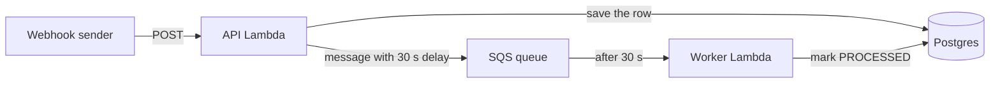

# Transaction Webhook Service

A Node.js service that receives transaction webhooks (RazorPay style), replies with `202 Accepted` straight away, and
then processes each transaction in the background 30 seconds later. Results are stored in Postgres.

**Live API: https://d2c87kyt7tmin7.cloudfront.net**

It runs on AWS (Lambda, SQS and CloudFront, in the Sydney region) with Supabase Postgres as the database.

| Method | Path | What it does |
|---|---|---|
| GET | `/` | health check |
| POST | `/v1/webhooks/transactions` | receive a webhook, answers `202` |
| GET | `/v1/transactions/{transaction_id}` | look up a transaction and its status |

Try it:

```bash
curl -i -X POST https://d2c87kyt7tmin7.cloudfront.net/v1/webhooks/transactions \
  -H 'content-type: application/json' \
  -d '{"transaction_id":"txn_abc123def456","source_account":"acc_user_789","destination_account":"acc_merchant_456","amount":1500,"currency":"INR"}'

curl https://d2c87kyt7tmin7.cloudfront.net/v1/transactions/txn_abc123def456
```

The status is `PROCESSING` at first and `PROCESSED` about 30 seconds later.

## How it works



1. The API checks the JSON body and saves it to Postgres. `transaction_id` is the primary key, so a duplicate webhook
   hits a conflict and is ignored. It still gets a `202`, because a sender that retries shouldn't be shown an error.
2. It puts a message on an SQS queue with a 30 second delay and returns `202`. That is all the request does, which is
   why it stays fast. CloudFront sits in front of the API Lambda.
3. 30 seconds later SQS hands the message to the worker Lambda. The worker locks the row, does the processing and sets
   `status` to `PROCESSED` and fills in `processed_at`.
4. If the worker fails it is retried up to 5 times. After that the message goes to a dead-letter queue and an alarm
   sends an email. Every 5 minutes a small job looks for transactions stuck in `PROCESSING` (a lost queue message, for
   example) and queues them again.

## API

### `POST /v1/webhooks/transactions`

Body fields:

- `transaction_id`: string, up to 128 characters (letters, digits and `_ . : -`). This is the idempotency key.
- `source_account` and `destination_account`: strings, up to 128 characters.
- `amount`: a number above 0 with at most 4 decimal places.
- `currency`: 3 letters. `inr` is stored as `INR`.

Extra fields are ignored. Types are strict, so `"amount": "1500"` (a string) is rejected.

Responses:

- `202`: accepted, `{"status":"ACCEPTED","duplicate":false}`. If the id was already received, `duplicate` is `true`.
  A duplicate is not an error.
- `400`: invalid body or broken JSON. The response lists every problem.
- `413` / `415`: body over 16 KB / not `application/json`.
- `500`: the transaction could not be saved or queued. Sending it again is safe.
- `401`: only when `WEBHOOK_SECRET` is set and the signature is missing or wrong.

Signature check (optional): if `WEBHOOK_SECRET` is set, requests need an `X-Webhook-Signature` header with the hex
HMAC-SHA256 of the body (RazorPay's `X-Razorpay-Signature` works too). It's not set on the live deployment, so plain
curl requests work.

### `GET /v1/transactions/{transaction_id}`

Returns an array with the transaction:

```json
[
  {
    "transaction_id": "txn_abc123def456",
    "source_account": "acc_user_789",
    "destination_account": "acc_merchant_456",
    "amount": 1500,
    "currency": "INR",
    "status": "PROCESSED",
    "created_at": "2024-01-15T10:30:00.000Z",
    "processed_at": "2024-01-15T10:30:30.512Z"
  }
]
```

`status` is `PROCESSING` (with `processed_at` null), `PROCESSED`, or `FAILED` when all retries were used up. An unknown
id gives `404`. Errors always look like `{"error": {"code": "...", "message": "..."}}`, and internal details only go to
the logs.

## Run it locally

You need Node.js 22 or newer, Docker (for Postgres) and npm. No AWS account is needed: locally the queue is an
in-memory stand-in that feeds the same processing code the worker Lambda uses.

```bash
npm install
cp .env.example .env          # on Windows PowerShell: Copy-Item .env.example .env
npm run db:up                 # Postgres in Docker, port 5433
npm run migrate               # creates the transactions table
npm run dev                   # http://localhost:3000
```

Set `PROCESS_DELAY_SECONDS=5` in `.env` if you don't want to wait 30 seconds. Then:

```bash
curl -X POST localhost:3000/v1/webhooks/transactions -H 'content-type: application/json' \
  -d '{"transaction_id":"txn_1","source_account":"a","destination_account":"b","amount":150.5,"currency":"USD"}'
curl localhost:3000/v1/transactions/txn_1      # PROCESSING, then PROCESSED a few seconds later
```

The local queue isn't durable. If you restart the dev server, pending jobs are lost until the reconciler queues them
again.

## Testing

```bash
npm run test:unit      # fast, no database needed
npm run db:up          # the integration tests use a real Postgres
npm test               # everything, 222 tests
npm run check          # lint, formatting and all tests (what CI runs)
```

The integration tests cover the awkward cases: 50 identical webhooks arriving at once (one row, one queued job), five
simultaneous deliveries of the same job (processed once), a queue outage, and a worker that keeps failing until the
transaction ends up `FAILED` in the dead-letter queue.

### Testing the deployed API

One command runs the whole check against the live service. It takes about a minute because it waits for the real 30
seconds:

```bash
npm run smoke -- --url https://d2c87kyt7tmin7.cloudfront.net
```

It checks:

1. One webhook gives `202`, then `PROCESSING`, then `PROCESSED` about 30 seconds later.
2. The same webhook sent 10 times at once gives `202` every time but only one `duplicate: false`, and the stored record
   doesn't change.
3. 35 more webhooks while earlier ones are still pending all get `202`, with a server-side p95 under 500 ms.
4. Bad input is handled: an invalid body and broken JSON give `400`, the wrong content type gives `415`, an unknown id
   gives `404`.

By hand, in Git Bash (in PowerShell use `curl.exe` instead of `curl`):

```bash
API=https://d2c87kyt7tmin7.cloudfront.net
ID=txn_test_$(date +%s)
BODY="{\"transaction_id\":\"$ID\",\"source_account\":\"a\",\"destination_account\":\"b\",\"amount\":10,\"currency\":\"INR\"}"

curl -i -X POST $API/v1/webhooks/transactions -H 'content-type: application/json' -d "$BODY"   # 202, duplicate false
curl -i -X POST $API/v1/webhooks/transactions -H 'content-type: application/json' -d "$BODY"   # 202, duplicate true
curl $API/v1/transactions/$ID                                                                   # PROCESSING
sleep 35; curl $API/v1/transactions/$ID                                                         # PROCESSED
```

There is also `npm run load-test -- --url <api> --connections 5 --requests 300`. Every request creates a real
transaction, so keep the numbers small on a new AWS account.

## Technical choices

- **Node.js 22 and Express 5, in plain JavaScript.** Express is simple and widely known, and its overhead is tiny next
  to the database and network time that decide whether a request fits in 500 ms. Plain JavaScript means no build step.
  Safety comes from runtime validation (Ajv for requests, zod for configuration), database constraints and tests.
- **A queue instead of processing inside the request.** The webhook handler only validates, saves and enqueues, so the
  `202` doesn't depend on how slow the processing is.
- **SQS `DelaySeconds=30` for the 30 second wait.** The delay lives in the queue, so nothing sleeps and nothing is lost
  if a server restarts. A `setTimeout` would drop jobs on every restart.
- **Postgres decides what counts as a duplicate.** The primary key plus `INSERT ... ON CONFLICT DO NOTHING` is correct
  across any number of Lambda instances, which an in-memory check isn't. SQS can deliver a message twice, so the worker
  also locks the row (`SELECT ... FOR UPDATE`) and the second delivery does nothing.
- **Save first, queue second.** A webhook is never acknowledged unless it's stored. If the process dies between the two
  steps, the sender's retry or the 5 minute reconciler queues it again.
- **Lambda behind CloudFront.** It scales with traffic and costs almost nothing when idle. CloudFront cuts the connection
  time for callers far from Sydney (see Performance below).
- **Supabase Postgres** through its transaction pooler, with one connection per Lambda container, so a burst of
  requests can't use up the database's connections.
- **SAM and GitHub Actions.** The infrastructure is in `template.yaml`. A push to `main` runs lint and the tests,
  applies the migrations, deploys, and then runs the smoke test against the live URL.
- **Optional HMAC signature check**, since real payment webhooks are signed. It's off unless `WEBHOOK_SECRET` is set,
  so plain test requests aren't blocked.
- **Region.** My AWS account is inside an organization whose policy only allows a few regions, and Mumbai isn't one of
  them. I used Sydney, the nearest allowed, and put Supabase there too. The Diagnose AWS access workflow in this repo
  is how I found out which regions work.

Things I looked at and left out: BullMQ with Redis (it needs a worker that's always running, which Lambda isn't), an ORM
(heavier cold starts for a single table), and API Gateway (extra cost, nothing gained here).

Project layout:

```
src/
  app.js, container.js       the Express app, and the one place where the queue and database are chosen
  config/                    validated environment settings
  modules/transactions/      routes, controller, service, repository, schema, processor
  infrastructure/            database, queue (SQS and in-memory), logging
  handlers/                  Lambda entry points: api, worker, reconciler
scripts/                     migrate, dev server, smoke test, load test, db check
migrations/                  SQL
infra/                       one-time setup of the deploy identity for GitHub Actions
tests/                       mirrors src/ (unit and integration)
template.yaml                the AWS infrastructure (SAM)
```

Files are named in kebab-case with a role suffix (`transactions.service.js`), imports use `#src/...` aliases, and
ESLint and Prettier enforce this in CI.

## Deploying

Pushing to `main` deploys through `.github/workflows/deploy.yml`. Setting up your own copy (AWS, Supabase, GitHub
secrets) is covered step by step in [docs/deployment-guide.md](docs/deployment-guide.md).

## Performance

The webhook handler itself typically takes 20 to 60 ms. Every response has a `Server-Timing` header with the application's own
time. The total time depends on where you call from. From my laptop in India, about 300 ms from Sydney, a request
through CloudFront takes 0.35 to 0.45 s end to end, but roughly one in ten is slower (around 0.9 s) when CloudFront has
to open a new connection to Sydney. Calling the Lambda directly was about 1 s every time because of the TLS handshake
round trips, which is why I added CloudFront. A caller closer to Sydney, or one that reuses connections, sees much
less. The numbers and how I measured them are in [docs/performance.md](docs/performance.md).

## Known limitations

- The first request after a quiet period can take longer than 500 ms because the Lambda has to start and connect to
  the database. A warm-up ping every 5 minutes reduces this.
- The live deployment accepts unsigned webhooks, and `GET /v1/transactions/{id}` has no authentication. Both are on
  purpose so it can be tested with plain curl. Setting the `WEBHOOK_SECRET` secret and redeploying turns signatures on.
- The Lambda's own URL is public as well, so callers can skip CloudFront.
- The connection to the database is encrypted, but the server certificate isn't verified (Supabase's certificate isn't
  in Node's trust store). The database URL is stored as a Lambda environment variable instead of in Secrets Manager.
- The GitHub pipeline signs in with a long-lived IAM access key, because my account's organization blocks the keyless
  OIDC option. The key only has access to this stack's resources and should be deleted when the project is finished.
- The processing step is a placeholder. The 30 seconds come from the queue, and the real work would go in
  `transactions.processor.js` (it has to be safe to run twice).

Next steps I'd take: an outbox instead of the reconciler, per-provider signature schemes, rate limiting with API Gateway
and a WAF, and tracing.

## More documentation

- [docs/deployment-guide.md](docs/deployment-guide.md): setting up AWS, Supabase and GitHub and deploying your own copy
- [docs/performance.md](docs/performance.md): latency measurements and how to read them
- [docs/operations.md](docs/operations.md): configuration reference, alarms, redriving failed messages, database check
- [docs/design-and-plan.md](docs/design-and-plan.md): the original design and the decisions behind it
