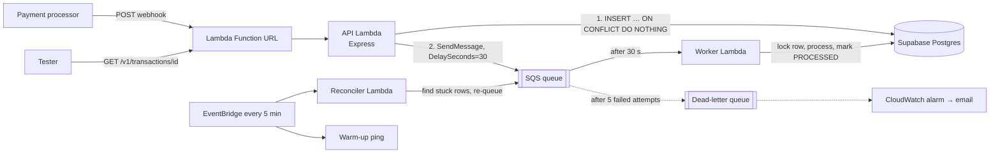
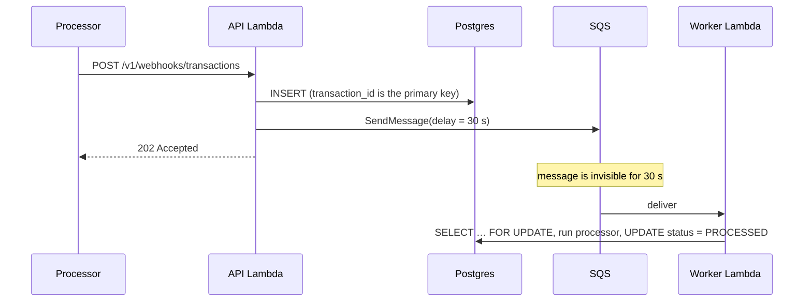

# Transaction Webhook Service

A service that receives transaction webhooks from payment processors (RazorPay-style), **acknowledges
them immediately with `202 Accepted`**, and **processes every transaction exactly once in the
background after a 30-second delay**, storing the result in Postgres.

Built with Node.js (Express 5) on AWS Lambda, SQS and Supabase Postgres.

| | |
|---|---|
| **Public API** | **https://xr4owskbawbjsmihvcdnk7w5i40ilffm.lambda-url.ap-southeast-2.on.aws** |
| **Health check** | `GET /` |
| **Webhook** | `POST /v1/webhooks/transactions` → `202` |
| **Query (for testing)** | `GET /v1/transactions/{transaction_id}` |
| **Region** | `ap-southeast-2` (Sydney) for AWS and Supabase. The AWS account's organization policy only permits certain regions (Mumbai is blocked); see [Diagnosing AWS restrictions](#diagnosing-aws-restrictions). |

## Contents

1. [How it works](#how-it-works)
2. [API reference](#api-reference)
3. [Run it locally](#run-it-locally)
4. [Test it](#test-it) — including the four success criteria
5. [Technical choices and trade-offs](#technical-choices-and-trade-offs)
6. [Reliability and idempotency](#reliability-and-idempotency)
7. [Project structure and conventions](#project-structure-and-conventions)
8. [Configuration](#configuration)
9. [Deploy and operate](#deploy-and-operate)
10. [Known limitations and next steps](#known-limitations-and-next-steps)
11. [Development notes](#development-notes)

---

## How it works



**The request path does as little as possible**, so it stays well inside the 500 ms budget: validate the
body, write one row, send one queue message, answer `202`. Nothing slow happens before the answer.



How each requirement is met:

| Requirement | How |
|---|---|
| Respond `202` within 500 ms regardless of load | The handler only validates, inserts and enqueues. Processing is never inline. Lambda scales out per request. |
| 30-second background delay | SQS `DelaySeconds=30`. No process sleeps, nothing is lost on restart, and Lambda is not billed while waiting. |
| Persistent result | Supabase Postgres `transactions` table with `status`, `created_at`, `processed_at`. |
| Same `transaction_id` processed once | Primary key + `ON CONFLICT DO NOTHING` at intake; a row lock in the worker. Duplicates answer `202`, never an error. |
| Reliability | Row is stored **before** the acknowledgement; SQS retries; dead-letter queue; scheduled reconciler; alarms. |
| Scalable | Stateless compute, queue between intake and processing, capped worker concurrency, one reused DB connection per container. |

---

## API reference

### `GET /` — health check

```bash
curl https://<api>/
```
```json
{ "status": "HEALTHY", "current_time": "2024-01-15T10:30:00.000Z" }
```
Makes no database call, so it stays instant and cannot fail because a dependency is slow.

### `POST /v1/webhooks/transactions` — receive a webhook

```bash
curl -i -X POST https://<api>/v1/webhooks/transactions \
  -H 'content-type: application/json' \
  -d '{
    "transaction_id": "txn_abc123def456",
    "source_account": "acc_user_789",
    "destination_account": "acc_merchant_456",
    "amount": 1500,
    "currency": "INR"
  }'
```
```
HTTP/1.1 202 Accepted
{"status":"ACCEPTED","duplicate":false}
```

| Field | Rules |
|---|---|
| `transaction_id` | string, 1–128 characters of `A-Z a-z 0-9 _ . : -`. The idempotency key. |
| `source_account`, `destination_account` | string, 1–128 characters |
| `amount` | number, greater than 0, at most 4 decimal places (`150.5` and `1500` are both fine) |
| `currency` | 3 letters (`INR`, `usd` → stored as `USD`) |

Extra fields are ignored. Types are strict: `"1500"` (a string) is rejected rather than silently converted.

| Status | When |
|---|---|
| `202` | Accepted. `duplicate: true` if this `transaction_id` was already received. **A duplicate is not an error.** |
| `400` | Invalid or malformed body (`VALIDATION_ERROR` lists every problem; `BAD_REQUEST` for broken JSON) |
| `401` | Only when `WEBHOOK_SECRET` is configured and the signature is missing or wrong |
| `413` / `415` | Body larger than 16 KB / not `application/json` |
| `500` | The transaction could **not** be stored or queued. The sender should retry; retrying is safe. |

**Optional signature check.** If `WEBHOOK_SECRET` is set, requests must carry
`X-Webhook-Signature` (or RazorPay's `X-Razorpay-Signature`): the hex HMAC-SHA256 of the exact request body.
If it is not set, no signature is required.

```bash
BODY='{"transaction_id":"txn_1","source_account":"a","destination_account":"b","amount":10,"currency":"INR"}'
SIG=$(printf '%s' "$BODY" | openssl dgst -sha256 -hmac "$WEBHOOK_SECRET" | awk '{print $2}')
curl -X POST https://<api>/v1/webhooks/transactions -H 'content-type: application/json' \
  -H "X-Webhook-Signature: $SIG" -d "$BODY"
```

### `GET /v1/transactions/{transaction_id}` — read status (for testing)

```bash
curl https://<api>/v1/transactions/txn_abc123def456
```
```json
[
  {
    "transaction_id": "txn_abc123def456",
    "source_account": "acc_user_789",
    "destination_account": "acc_merchant_456",
    "amount": 1500,
    "currency": "INR",
    "status": "PROCESSED",
    "created_at": "2024-01-15T10:30:00.000Z",
    "processed_at": "2024-01-15T10:30:30.512Z"
  }
]
```
The response is an array (as specified). `status` is `PROCESSING` (with `processed_at: null`), `PROCESSED`, or
`FAILED` (all retries used up; see [operations](#deploy-and-operate)). An unknown id returns `404`.

All errors share one shape: `{ "error": { "code": "…", "message": "…", "details": […] } }`. Internal details are
never returned; they go to the logs, tied to the response by the `x-request-id` header.

---

## Run it locally

Needs Node.js 22+, Docker (for Postgres) and npm. **No AWS account is needed**: locally the queue is an
in-memory stand-in that delivers to the same processing code the worker Lambda runs.

```bash
npm install
cp .env.example .env          # Windows PowerShell: Copy-Item .env.example .env
npm run db:up                 # starts Postgres in Docker on port 5433
npm run migrate               # creates the transactions table
npm run dev                   # http://localhost:3000
```

Set `PROCESS_DELAY_SECONDS=5` in `.env` for quicker feedback (the default is 30). Then:

```bash
curl -X POST localhost:3000/v1/webhooks/transactions -H 'content-type: application/json' \
  -d '{"transaction_id":"txn_1","source_account":"a","destination_account":"b","amount":150.5,"currency":"USD"}'
curl localhost:3000/v1/transactions/txn_1      # PROCESSING … then PROCESSED a few seconds later
```

> The local queue is **not durable** (a restart loses pending jobs, which the built-in reconciler then
> re-queues). It exists only for development and tests.

---

## Test it

```bash
npm run check            # lint + formatting + every test (what CI runs)
npm run test:unit        # fast tests, no database
npm run test:integration # real Postgres (npm run db:up first)
npm run test:coverage    # with a coverage report in ./coverage
```

**215 tests, ~99% statement and 100% line coverage** (thresholds are enforced). They include:

- **Concurrency:** 50 simultaneous identical webhooks produce exactly one row and one queued job; 5 simultaneous
  deliveries of one job run the processor once.
- **Failure:** queue outage (500, nothing lost, repaired by the sender's retry or the reconciler), transient
  failures retried, a permanent failure ending as `FAILED` and dead-lettered, then completed after a redrive.
- **Wiring:** the real Lambda entry points, configured from environment variables, against Postgres.
- **The tools themselves:** the smoke and load scripts run against a real server, including a run that **must fail**
  against a broken one, so a green result means something.

### Verify the four success criteria against a running service

One command checks all of them and exits non-zero on any failure (about a minute, because of the real 30 s delay):

```bash
npm run smoke -- --url https://<api>                 # add --secret <s> if signatures are enforced
```

| # | Criterion | What the smoke test does |
|---|---|---|
| 1 | **Single transaction** | Sends one webhook, expects `202`, then `PROCESSING`, then `PROCESSED` about 30 s later; checks `processed_at − created_at ≈ 30 s`. |
| 2 | **Duplicate prevention** | Sends the same webhook 10× at once: all `202`, exactly one `duplicate:false`; replays after processing and checks the record is unchanged. |
| 3 | **Performance** | 35 more webhooks while earlier work is still pending: all `202`, and the **server-side p95 < 500 ms** (the application's own time, from the `Server-Timing` header). End-to-end time is printed too; it also contains the network distance from wherever the test runs, so it only fails the run with `--strict-e2e`. |
| 4 | **Reliability** | Invalid body → `400`, broken JSON → `400`, wrong content type → `415`, unknown id → `404`, unsigned → `401` (if a secret is set). |

The same by hand:

```bash
API=https://<api>
curl -X POST $API/v1/webhooks/transactions -H 'content-type: application/json' -d '{…}'   # → 202
curl $API/v1/transactions/<id>                                                              # → PROCESSING
sleep 35; curl $API/v1/transactions/<id>                                                    # → PROCESSED
for i in 1 2 3; do curl -s -X POST $API/v1/webhooks/transactions … ; done                   # same id → 202 each
```

Load test (every request creates a real transaction; keep `--connections` modest on a new AWS account, which may
allow only ~10 concurrent Lambda executions in total):

```bash
npm run load-test -- --url https://<api> --connections 5 --requests 300
```

**Measured results**

| Where | Result |
|---|---|
| Local dev server, 5 connections, 500 requests | all `202`; p50 31 ms, p95 59 ms, p99 66 ms, max 117 ms; ~140 req/s |
| **Deployed on AWS (Sydney)**, smoke test from a GitHub Actions runner far from Sydney | all `202`. **Server-side** (Server-Timing): p50 **18 ms**, p95 **137 ms**, max 152 ms. **End to end**: p50 186 ms, p95 599 ms (about 170 ms of network round trip per request; a fresh HTTPS connection costs about three). First request after the deploy, **a cold Lambda plus a new connection: 809 ms**. Background processing finished **31.5 s** after creation. |

**Reading latency numbers: server time vs network time.** A request's total time is network travel plus the server's
own work. Every response carries a standard `Server-Timing: app;dur=…` header with the application's own time in
milliseconds (it excludes network travel and a Lambda cold start), so the two can be told apart:

```bash
# the server's own time for this request
curl -si https://<api>/ | grep -i server-timing

# the full breakdown as a client sees it (DNS, TCP, TLS handshake, first byte, total)
curl -s -o /dev/null https://<api>/ \
  -w 'dns %{time_namelookup}s | tcp %{time_connect}s | tls %{time_appconnect}s | first byte %{time_starttransfer}s | total %{time_total}s\n'
```

The smoke and load tests print both the end-to-end and the server-side figures. The service runs in Sydney, so a
caller far away pays several network round trips before the server even starts (a fresh HTTPS connection needs about
three), and a network round trip of 150 to 400 ms is enough to consume most of a 500 ms budget by itself.

> Local numbers show the application code is fast; they are **not** a prediction of AWS latency. The first request
> to a cold Lambda also pays for starting the function and opening the database connection, which is the main
> risk to the 500 ms target. See [Known limitations](#known-limitations-and-next-steps).

---

## Technical choices and trade-offs

| Choice | Why | Trade-off |
|---|---|---|
| **Queue + worker** instead of processing in the request | The 500 ms acknowledgement holds however slow processing is; load is absorbed by the queue. | A transaction is briefly stored but not yet processed (visible as `PROCESSING`). |
| **SQS `DelaySeconds`** for the 30 s wait | Durable, free while waiting, survives restarts and deploys. A `setTimeout` would lose jobs on any restart. | Delivery time is "30 s plus a little queue jitter", not to-the-millisecond. |
| **Postgres primary key as the idempotency arbiter** | Correct across any number of concurrent Lambda instances; an in-memory check cannot be. | Every intake costs one database round trip. |
| **Row lock (`SELECT … FOR UPDATE`) in the worker** | At-least-once delivery means duplicates *will* happen; the lock makes the external call run once per commit. | A worker holds a connection while processing (fast here; the 30 s wait is in the queue). |
| **Store first, then enqueue** | A transaction is never acknowledged unless it is durably saved. | A crash between the two leaves a stored-but-unqueued row, which the sender's retry or the reconciler repairs. |
| **Scheduled reconciler** | Makes "no transaction is lost" true even if a queue message vanishes. Also keeps a free Supabase project awake. | One more function to run and alarm on. |
| **Serverless (Lambda + Function URL)** | Scales with traffic, costs about nothing idle, and fits the free tier. | Cold starts; the Function URL has no built-in throttling or WAF. |
| **Supabase Postgres** (transaction pooler) | Real constraints, `numeric` for money, easy to inspect. | Needs the pooler and a small pool per container to avoid exhausting connections. |
| **Express 5** | Familiar and easy to explain. Framework overhead is negligible next to the database, SQS and cold-start costs that dominate the 500 ms budget. | Validation is added with Ajv rather than built in. |
| **Plain JavaScript (ESM)** | No build step; safety comes from runtime validation (Ajv, zod config), database constraints and tests. | No compile-time type checking. |
| **SAM + GitHub Actions** | Simple IaC and a one-push deploy. The pipeline signs in with keyless OIDC where the account allows it, otherwise with a least-privilege IAM user. | AWS-specific. The IAM-user mode stores a long-lived key as a GitHub secret (see below). |
| **Optional HMAC check** | Realistic for payment webhooks, but does not break plain test requests. | Off unless `WEBHOOK_SECRET` is set. |

**Considered and rejected:** BullMQ + Redis (needs an always-running worker, which Lambda isn't); processing in the
request path (fails the 500 ms requirement under load); an ORM (heavier cold starts for one table); API Gateway
(extra cost for no benefit here); FIFO SQS (extra constraints; the database already deduplicates).

**Supabase's public API is locked off.** Supabase exposes tables in the `public` schema through an auto-generated
REST API. This service never uses it (it connects to Postgres directly), so migration `0002` enables row-level security
on the table with no policies: the API roles can read and write nothing, while the service's own connection is
unaffected. A test proves a low-privilege role sees zero rows.

**Money:** amounts are `numeric(20,4)` in the database and exact decimal strings in the code. They become JSON
numbers only at the API edge.

---

## Reliability and idempotency

| What goes wrong | What happens |
|---|---|
| The same webhook arrives many times, even at once | One row, one queued job. The others answer `202` with `duplicate: true`. |
| Same `transaction_id`, different data | The first record wins and is never overwritten; a warning is logged with the differing field names. |
| The API crashes after saving but before queuing | The processor's retry re-queues it; if it never retries, the reconciler does within minutes. |
| The queue is down | The API answers `500` (the row is already saved); the retry repairs it. An alarm fires. |
| SQS delivers a message twice | The row lock makes the second delivery a no-op. |
| The worker crashes or a call fails mid-processing | The change rolls back; SQS redelivers; up to 5 attempts. |
| It keeps failing | After the last attempt the row is marked `FAILED` with `last_error`, the message goes to the dead-letter queue and an alarm emails you. |
| A bug is fixed after a failure | Redrive the dead-letter queue; the `FAILED` transaction completes. |
| A queue message is lost | The reconciler finds transactions stuck in `PROCESSING` and re-queues them. |

---

## Project structure and conventions

```
src/
  app.js                     createApp(): builds the Express app, never listens
  container.js               composition root: the only place adapters are chosen
  config/env.js              validated configuration
  constants/                 http-status, error-codes, log-events
  errors/  middlewares/      HTTP errors; one concern per *.middleware.js
  modules/
    health/                  routes + controller
    transactions/            routes → controller → service → repository (+ schema, mapper, processor)
  infrastructure/            database/ (pool, migrator)   queue/ (SQS + in-memory)   logging/
  lib/                       framework-free helpers (webhook signature)
  handlers/                  AWS Lambda entry points: api, worker, reconciler
scripts/                     command-line tools: migrate, dev-server, smoke-test, load-test
migrations/                  versioned SQL
infra/                       one-time AWS setup: the deploy identity for GitHub Actions
tests/                       mirrors src/ (unit + integration)
template.yaml                the application's AWS infrastructure (SAM)
```

Conventions, enforced by ESLint/Prettier rather than just habit: `kebab-case` file names with a role suffix
(`transactions.service.js`), `node:` prefixes for built-ins, `#src/…` subpath imports instead of `../../..`,
named constants instead of magic numbers and strings, layers that depend only downward (HTTP never knows about SQS
or Postgres), LF line endings.

---

## Configuration

Environment variables, validated at startup (the process refuses to start with a clear message if one is wrong).

| Variable | Default | Meaning |
|---|---|---|
| `DATABASE_URL` | _required_ | Postgres connection string. On AWS use Supabase's **transaction pooler** (port 6543). |
| `DATABASE_URL_DIRECT` | – | Used by migrations. Use Supabase's **session pooler** string (IPv4); the direct connection is IPv6-only. |
| `DB_SSL` | `require` | `disable` for the local Docker database |
| `DB_POOL_MAX` | `1` | Connections per container; Lambda concurrency bounds the total |
| `QUEUE_DRIVER` | `sqs` | `memory` for local runs and tests only |
| `QUEUE_URL` | – | Required when `QUEUE_DRIVER=sqs` |
| `PROCESS_DELAY_SECONDS` | `30` | Delay before processing (SQS maximum 900) |
| `MAX_RECEIVE_COUNT` | `5` | Attempts before the dead-letter queue; must equal the queue's redrive policy |
| `WEBHOOK_SECRET` | – | Enables the HMAC signature check (min 8 characters) |
| `REPAIR_GRACE_SECONDS` | `10` | A duplicate younger than this is assumed to be racing the original request |
| `RECONCILE_AFTER_SECONDS` | `120` | Re-queue stuck transactions older than this (must exceed the delay) |
| `RECONCILE_RETRYING_AFTER_SECONDS` | `1800` | Same, for transactions already being retried |
| `RECONCILE_BATCH_SIZE` | `100` | Rows per reconciler run |
| `LOG_LEVEL` | `info` | `fatal` … `trace`, or `silent` |

---

## Deploy and operate

Full account setup (AWS, Supabase, GitHub) is in [AWS_SETUP.md](AWS_SETUP.md). In short:

**One-time** (as an AWS admin): create the stack in `infra/github-deploy-access.yaml`. It makes a least-privilege
identity that can deploy only this application's resources, in one of two modes:

| Mode | Use when | GitHub secrets |
|---|---|---|
| `oidc` (preferred) | the AWS account allows creating an OIDC provider | `AWS_ROLE_ARN`. No keys are stored anywhere. |
| `user` | an organization policy forbids OIDC providers (this project's account does) | `AWS_ACCESS_KEY_ID` + `AWS_SECRET_ACCESS_KEY` of the created IAM user. This is a **long-lived key**: scoped to this stack's resources, but still a secret to protect. Delete the user and key when you are done. |

Then add these secrets to the GitHub Environment `production`:

| Secret | Value |
|---|---|
| `AWS_ROLE_ARN` **or** the two `AWS_*` keys | from the mode above (set one set, never both) |
| `DATABASE_URL` | Supabase **transaction pooler** string (port 6543) |
| `DATABASE_URL_DIRECT` | Supabase **session pooler** string (for migrations) |
| `ALERT_EMAIL` | where alarms are sent (confirm the SNS email after the first deploy) |
| `WEBHOOK_SECRET` | optional HMAC secret |
**Every push to `main`** runs `.github/workflows/deploy.yml`: lint, format, tests → apply migrations → `sam build`
→ `sam deploy` → read the URL from the stack outputs → run the smoke test against the live service.

**Manual deploy**

```bash
npm install -g esbuild
sam build
sam deploy --guided                                   # first time; afterwards: sam deploy
# parameters: DatabaseUrl=…  AlertEmail=…  [WebhookSecret=…]
```

**Tear down:** `sam delete --stack-name transaction-webhook-service`, then delete the access-stack (and with it the IAM user and its key) in the CloudFormation console.

### Checking the database connection

`npm run db:check` tests both connection strings the way the app uses them (`DATABASE_URL` and
`DATABASE_URL_DIRECT`, from the environment or `.env`): whether each connects, how fast it answers, whether a
multi-statement transaction works through the pooler, whether the schema exists, and whether the database sits in the
same region as the application (`EXPECTED_DB_REGION`, default `ap-southeast-2`). Passwords are never printed. Run it before
the first deploy and whenever a connection problem is suspected.

### Diagnosing AWS restrictions

Some AWS accounts sit inside an AWS Organization whose policies (service control policies) forbid certain actions,
and each one only shows up as a failed deploy. The manual workflow **Actions → Diagnose AWS access** (script:
`scripts/diagnose-aws-access.sh`) tries every action the deployment needs on throwaway resources, deletes them again,
and reports each as `ALLOWED`, `BLOCKED BY ORGANIZATION (SCP)` (nothing in the account can undo this), or
`DENIED BY OUR IAM POLICY` (fixable in `infra/github-deploy-access.yaml`).

### Operating it

Seven alarms email you: dead-letter queue not empty, queue backlog > 5 min, a transaction marked `FAILED`, an
unhandled API error, API throttling, and worker or reconciler crashes.

```bash
# What failed, and why?
SELECT transaction_id, attempts, last_error FROM transactions WHERE status = 'FAILED';

# Redrive dead-lettered messages after fixing the cause
DLQ_URL=$(aws cloudformation describe-stacks --stack-name transaction-webhook-service \
  --query "Stacks[0].Outputs[?OutputKey=='DeadLetterQueueUrl'].OutputValue" --output text)
DLQ_ARN=$(aws sqs get-queue-attributes --queue-url "$DLQ_URL" --attribute-names QueueArn \
  --query Attributes.QueueArn --output text)
aws sqs start-message-move-task --source-arn "$DLQ_ARN"
```

Logs are structured JSON in CloudWatch (`/aws/lambda/transaction-webhook-service-{api,worker,reconciler}`).
CloudWatch Logs Insights: `fields @timestamp, event, transaction_id, request_id | filter event = "txn.failed"`.

---

## Known limitations and next steps

- **Cold start.** The first request to a cold Lambda includes starting the function and opening the database
  connection, and may exceed 500 ms. Mitigations in place: same region for AWS and Supabase, a small bundle, a
  warm-up ping every 5 minutes, one reused connection. Provisioned concurrency would remove it but is not free.
  _Measured on the deployed service: the first request took 809 ms end to end (see the results table above)._
- **Network distance counts against the 500 ms budget.** The AWS account's organization permits regional services only in
  a few regions, and the closest to India is Sydney. A caller far from Sydney pays a network round trip on every
  request, and a brand-new HTTPS connection costs about three of them, so end-to-end time from far away can exceed
  500 ms even though the application itself answers in tens of milliseconds (see `Server-Timing`). Putting a CDN in
  front (for example CloudFront, which terminates the connection near the caller) is the standard remedy and would be
  the next step, subject to the organization allowing it.
- **The acknowledgement waits for the database and queue.** That is deliberate (nothing is acknowledged unless it is
  safe). If cold starts proved too slow, the alternative is to queue first and let the worker write to the database.
- **Brand-new AWS accounts** may be limited to ~10 concurrent Lambda executions; worker concurrency is capped
  (default 5) to leave room for the API.
- **No authentication on the query endpoint** (it is for testing, as specified). Production would protect it.
- **The processing step is a stub** (the delay comes from the queue). The real external call goes in
  `transactions.processor.js`; it must be safe to retry.
- **Free tiers.** The AWS Free plan ends after 6 months or when credits run out (Lambda and SQS usage here is
  tiny); a free Supabase project pauses after a week of inactivity, which the reconciler prevents.
- **Next steps:** a transactional outbox/CDC instead of the reconciler, per-provider signature schemes, API Gateway +
  WAF for rate limiting, distributed tracing, and a dashboard.

---

## Development notes

This project was built with AI assistance (Claude Code). The work was reviewed and verified rather than accepted
as written: behaviour is pinned by tests, key safety properties were checked by deliberately breaking the code
(for example, removing the row lock makes the concurrent-delivery test fail), and several defects were found and
fixed this way. Examples: a corrupt compressed request body returned a 500 instead of a 400, a flaky latency test
did not reflect how Lambda really runs, and the reconciler would have duplicated messages for a transaction that
was still being retried.

_(Edit this section to describe your own involvement and decisions accurately.)_
